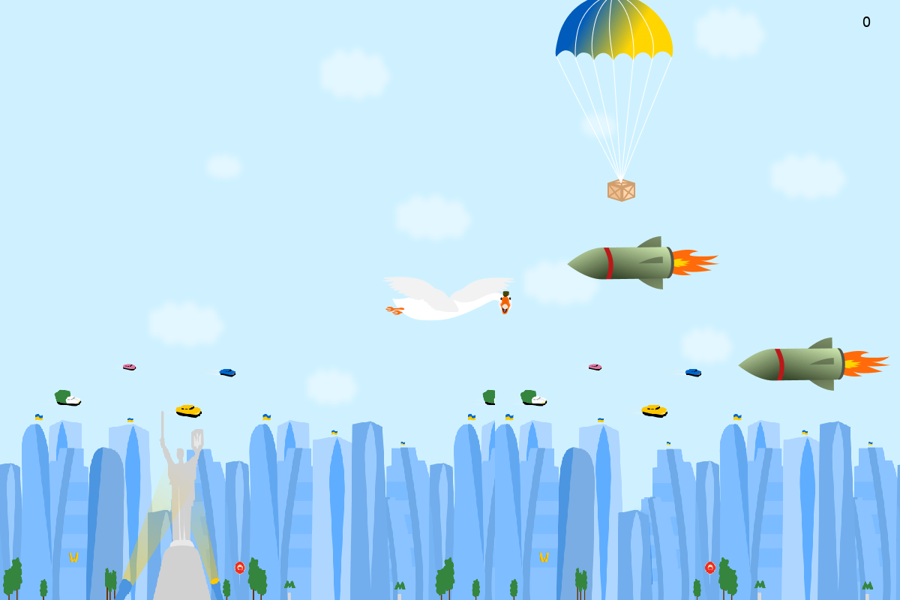

# Goose Game (Python, Pygame)

My first Python project: a small 2D arcade game I wrote in February 2024 during a 3-week online Python course.



You steer a goose over a scrolling city with the arrow keys. Rockets fly in from the right and end the game if they hit you. Supply drops fall from the top, and each one you catch adds a point.

## What the code does

- Runs the game loop at up to 120 frames per second with `pygame.time.Clock`.
- Uses custom timer events (`pygame.USEREVENT`) to spawn a rocket every 1.5 s, a supply drop every 3 s, and to switch the goose's animation frame every 200 ms.
- Scrolls the background endlessly by drawing two copies of it side by side.
- Moves the goose with the arrow keys and keeps it inside the window.
- Checks collisions with `Rect.colliderect`, counts the score, and removes objects that leave the screen.

## Run it

You need Python 3 and Pygame.

```bash
pip install -r requirements.txt
python main.py
```

Start it from this folder, because the images are loaded by relative paths.

## Notes

- The graphics come from the course materials, and the code follows the course lessons.
- I uploaded the project from my old laptop in October 2026. The only change since 2024 is a one-character fix to the enemy image path, which crashed the game on macOS and Linux (see the commit history).
